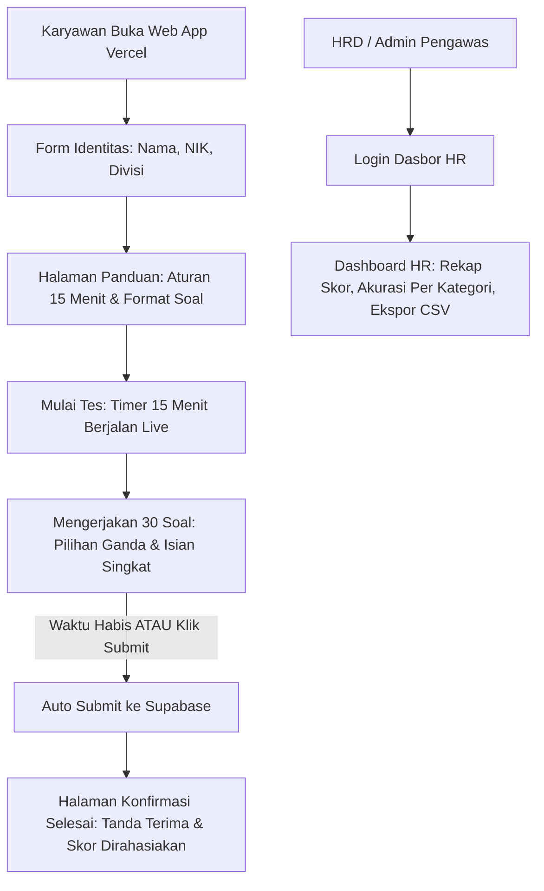

# Product Requirements Document (PRD)
## Aplikasi Tes Matematika Sederhana & Ketelitian Nominal Karyawan

---

### 1. Ringkasan Eksekutif (Executive Summary)
Aplikasi ini dirancang sebagai platform asesmen dan tes ketelitian matematika sederhana bagi karyawan atau calon karyawan. Tes berfokus pada kemampuan berhitung dasar (pertambahan, pengurangan) serta pemahaman nilai uang/nominal (konversi angka ke terbilang dan terbilang ke angka nominal rupiah). Aplikasi dibangun dengan arsitektur modern menggunakan **Next.js** yang dideploy di **Vercel** dan backend/database menggunakan **Supabase**.

---

### 2. Tujuan & Sasaran (Objectives & Scope)
1. **Mengukur Ketelitian & Kecepatan Berhitung**: Menilai kemampuan dasar operasi hitung dan pembacaan nominal uang yang krusial untuk operasional kantor/bisnis.
2. **Standardisasi Tes**: 30 butir soal berbobot dan bertingkat dari mudah, menengah, hingga sulit.
3. **Integritas Waktu Intensif (15 Menit)**: Sesi ujian berdurasi **15 menit** (rata-rata 30 detik/soal) dilengkapi hitung mundur otomatis yang mengunci dan mengirimkan jawaban saat waktu habis.
4. **Format Jawaban Campuran (Hybrid)**:
   - *Pilihan Ganda (MCQ)*: untuk operasi hitung pertambahan & pengurangan.
   - *Isian Singkat (Text Input)*: untuk penulisan nominal angka dan penyebutan terbilang guna menguji ketelitian ejaan & format penulisan.
5. **Kerahasiaan Nilai**: Skor dan analisis hasil **hanya dapat diakses oleh Admin/HR**. Karyawan hanya menerima konfirmasi bahwa ujian telah selesai diserahkan.

---

### 3. Struktur Soal (30 Butir Soal Bergradasi)

| Tingkat Kesulitan | Jumlah Soal | Tipe Soal yang Diujikan | Format Jawaban | Contoh Soal |
| :--- | :--- | :--- | :--- | :--- |
| **Mudah (Level 1)** | 10 Soal (No. 1-10) | - Pertambahan dasar<br>- Pengurangan dasar<br>- Penulisan & penyebutan nominal puluhan/ratusan ribu | Pilihan Ganda (Hitungan)<br>Isian Singkat (Nominal) | `450 + 725 = ...`<br>`1.000 - 375 = ...`<br>Ketik: "Tujuh puluh lima ribu rupiah" |
| **Menengah (Level 2)** | 10 Soal (No. 11-20) | - Pertambahan 4-5 digit<br>- Pengurangan multi digit / kembalian<br>- Penulisan nominal jutaan rupiah<br>- Konversi angka ke terbilang | Pilihan Ganda (Hitungan)<br>Isian Singkat (Nominal) | `12.450 + 47.750 = ...`<br>`100.000 - 43.650 = ...`<br>Tulis angka: "Dua juta tiga ratus lima puluh ribu rupiah" |
| **Sulit (Level 3)** | 10 Soal (No. 21-30) | - Operasi hitung beruntun / campuran (+ dan -)<br>- Studi kasus penerimaan kas & anggaran belanja<br>- Nominal puluhan/ratusan juta rupiah | Pilihan Ganda (Hitungan)<br>Isian Singkat (Nominal) | `(1.500.000 + 750.000) - 425.000 = ...`<br>Terbilang dari: `Rp 305.080.090`<br>Nominal untuk: "Sembilan ratus delapan juta tujuh ribu rupiah" |

---

### 4. Perjalanan Pengguna (User Flow)



---

### 5. Kebutuhan Fungsional (Feature Requirements)

#### A. Modul Karyawan (Peserta Ujian)
1. **Identitas Peserta Sederhana**: Cukup mengisi **Nama Lengkap** saja sebelum memulai tes (tanpa perlu mengisi NIK, divisi, atau pendaftaran akun berbelit-belit).
2. **Antarmuka Ujian Responsif**:
   - Floating timer hitung mundur (default 15 menit atau sesuai konfigurasi HR).
   - Indikator status nomor soal 1 - 30 (Kosong, Terjawab, Ragu-ragu).
   - Mode isian cerdas untuk nominal rupiah (placeholder contoh format).
3. **Pencegahan Kehilangan Data**: Auto-save jawaban per butir soal ke state/local storage.
4. **Auto-Submit On Timeout**: Otomatis menutup ujian dan menyimpan nilai saat waktu habis.
5. **Halaman Tanda Terima**: Karyawan menerima bukti pengerjaan resmi tanpa memperlihatkan rincian nilai.


#### B. Modul Admin / HR (Dasbor Supabase)
1. **Daftar Hasil & Leaderboard**: Tabel nilai lengkap dengan filter divisi dan tanggal.
2. **Pembedaan Akurasi**: Rincian persentase benar pada soal hitungan (MCQ) vs ketelitian penulisan nominal (Isian Singkat).
3. **Analisis Soal Sulit**: Mengetahui nomor soal yang paling banyak gagal dijawab karyawan.
4. **Manajemen Bank Soal (CRUD Soal)**:
   - Form Tambah & Edit Soal: Atur nomor urut (1-30), kategori, tingkat kesulitan, tipe jawaban (Pilihan Ganda / Isian Singkat), teks soal, opsi A/B/C/D, dan kunci jawaban.
   - Fitur Ganti Soal Cepat: Ubah satu butir soal secara spesifik tanpa mengganggu soal lainnya.
   - Import JSON Massal: Unggah paket 30 soal sekaligus dari output AI Generator.
5. **Menu Pengaturan Waktu Ujian (Timer Settings)**:
   - Pengaturan dinamis durasi ujian (default 15 menit, dapat disesuaikan menjadi 10, 20, 30 menit, dll.).
   - Pengaturan ambang peringatan waktu (misal: warna kuning saat < 3 menit, merah saat < 1 menit).
6. **Prompt Generator AI Terintegrasi**:
   - Menu khusus di dasbor HR yang menyediakan template prompt siap salin untuk ChatGPT/Gemini/Claude guna menghasilkan 30 soal baru secara instan.
7. **Ekspor Nilai**: Kemampuan download laporan evaluasi ke CSV/Excel.


---

### 6. Desain Database Supabase (Database Schema)

```sql
-- 1. Tabel Peserta / Karyawan (Hanya Nama Lengkap)
CREATE TABLE participants (
    id UUID PRIMARY KEY DEFAULT gen_random_uuid(),
    full_name VARCHAR(150) NOT NULL,
    created_at TIMESTAMPTZ DEFAULT NOW()
);

-- 2. Bank Soal (30 Soal)
CREATE TABLE questions (
    id SERIAL PRIMARY KEY,
    question_order INT NOT NULL,
    category VARCHAR(50) NOT NULL, -- 'addition', 'subtraction', 'nominal_to_text', 'text_to_nominal', 'mixed'
    difficulty VARCHAR(20) NOT NULL, -- 'easy', 'medium', 'hard'
    question_type VARCHAR(20) NOT NULL, -- 'mcq' atau 'input'
    question_text TEXT NOT NULL,
    options JSONB, -- Pilihan ganda [A, B, C, D] jika type = 'mcq'
    correct_answer TEXT NOT NULL,
    points INT DEFAULT 10,
    created_at TIMESTAMPTZ DEFAULT NOW()
);

-- 3. Sesi Ujian (Exam Sessions)
CREATE TABLE exam_sessions (
    id UUID PRIMARY KEY DEFAULT gen_random_uuid(),
    participant_id UUID REFERENCES participants(id) ON DELETE CASCADE,
    started_at TIMESTAMPTZ DEFAULT NOW(),
    finished_at TIMESTAMPTZ,
    time_limit_minutes INT DEFAULT 15,
    total_score NUMERIC(5,2) DEFAULT 0,
    total_correct INT DEFAULT 0,
    status VARCHAR(20) DEFAULT 'in_progress', -- 'in_progress', 'completed', 'timed_out'
    tab_switch_count INT DEFAULT 0
);

-- 4. Jawaban Detail Peserta
CREATE TABLE exam_answers (
    id UUID PRIMARY KEY DEFAULT gen_random_uuid(),
    session_id UUID REFERENCES exam_sessions(id) ON DELETE CASCADE,
    question_id INT REFERENCES questions(id),
    submitted_answer TEXT,
    is_correct BOOLEAN DEFAULT FALSE,
    time_spent_seconds INT,
    created_at TIMESTAMPTZ DEFAULT NOW()
);
```

---

### 7. Rencana Tahap Pengembangan Berikutnya
1. **Fase 1 (Selesai)**: Spesifikasi PRD & Mockup Interaktif.
2. **Fase 2**: Penyusunan proyek Supabase (Skema tabel & seeder 30 butir soal).
3. **Fase 3**: Scaffolding aplikasi Next.js (App Router, Tailwind CSS, Shadcn) di repo ini.
4. **Fase 4**: Integrasi logika ujian (Timer 15 menit, Hybrid input, auto-submit Supabase).
5. **Fase 5**: Pembuatan Dashboard HR & Deploy ke Vercel.
